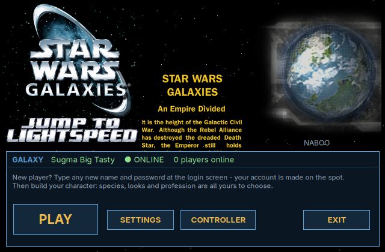
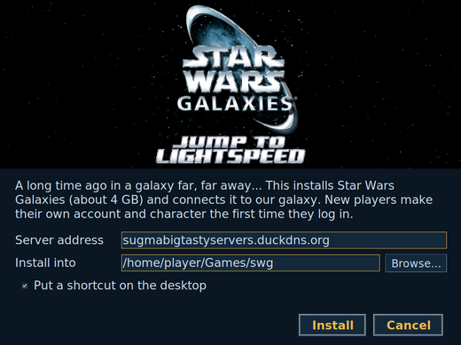

# Star Wars Galaxies: Sugma Big Tasty galaxy

**A long time ago in a galaxy far, far away...** This is a one-click installer and launcher for our Star Wars
Galaxies community server (Pre-CU with Jump to Lightspeed, running [SWGEmu Core3](https://github.com/swgemu/Core3)).
It works on Windows and Linux.

- **No sign-up page.** Type a new username and password at the login screen and your account is made on the spot.
- **Your character, your way.** Species, looks and starting profession are all picked in the game's own character creator.
- **A LaunchPad-style launcher.** It shows the Jump to Lightspeed logo, the opening crawl and the planet loading
  screens, all read from your own game files, plus Play, Settings and Controller buttons.
- **No game files are in this repository.** The installer downloads the free SWGEmu client files from SWGEmu's own
  patch server and checks every file's MD5. A re-run repairs damaged or missing files.
- **Controller support:** see [`controller/README.md`](controller/README.md) (Steam Input or AntiMicroX).

## Install

Download the latest **[release](../../releases/latest)** for your system and unzip it.

### Windows

1. Double-click **`Install Star Wars Galaxies.bat`**.
2. Pick the install folder (about 4 GB) and click **Install**. Leave the server address as it is.
3. Play with the **Star Wars Galaxies** shortcut. Graphics and sound: **Star Wars Galaxies Settings**.

If Windows says the DirectX 9 runtime is missing, the installer opens Microsoft's download page for it. The installer
builds `SWG Launcher.exe` on your PC from the C# source in `windows/launcher` (with the compiler that ships with
Windows), so there is no pre-built program to trust.

### Linux

1. Double-click **Install Star Wars Galaxies**, or run `./install-swg-linux.sh`.
2. It needs Wine (GE-Proton is used when Steam or Lutris has it), curl, and python3 with Tk for the setup window and
   launcher (`tk` on Arch, `python3-tk` on Debian and Ubuntu).
3. Play from your app menu or desktop.

## Good to know

- This is a fan-run emulator server, not the original servers. Expect the occasional restart. The admins watch over it.
- Already have the SWGEmu client files? Put them in a `client-files` folder next to the installer and it copies them
  instead of downloading them.
- The server source is SWGEmu Core3 (AGPL-3.0). Our exact changes are in [`server-changes/`](server-changes/).

## Credits

Star Wars Galaxies was made by Sony Online Entertainment and LucasArts. Star Wars is a trademark of Lucasfilm. They
own the game and its art. The server is [SWGEmu](https://www.swgemu.com/) (AGPL-3.0). The installer and launcher
code here is MIT-licensed (see `LICENSE`).
